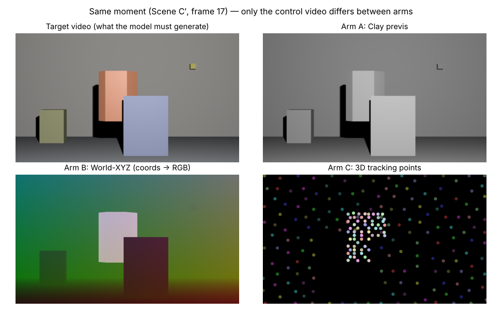

# 引き継ぎ資料（HANDOFF）— 2026-11-02 時点

このファイルだけ読めば、続きの作業ができるように書いてある。
**詳細の正本は `docs/protocol/protocol.md`（rev.18）と `docs/worklog/`。ここは索引と手順書。**

---

## 0. 3 行で

1. 卒論実験（Wan2.1-VACE-1.3B に 3D control を LoRA で教える、3 表現の比較）は**全部終わった**。論文 v1.0 も `docs/thesis/thesis.md` にある
2. 主な結果：**3 表現とも約 100 step で使えるようになる。精度は 粘土（A）≈ XYZ（B）> 追跡点（C）**（20 seed の事前登録した追加実験で有意）
3. 残りは「論文の仕上げ（参考文献の照合など）」と「拡張実験（§9 の優先順位）」。学習 run の予算は 5 / 5 で使い切っている

---

## 1. 研究の中身（初めて読む人向け）

### 何を比べたか

| Arm | 表現 | 中身 |
|---|---|---|
| A | Clay previs | 全部を灰色の粘土 1 色でレンダリングした動画。どれが主役か（Target）は書いていない |
| B | World-XYZ | 画素ごとの 3D 座標を RGB に詰めた動画。Target は別の色帯 |
| C | 3D Tracking | 物体表面の 240 点を固定色の円で描いた動画。Target は別の色帯 |

**違うのは control 動画だけ。** prompt・参照画像・解像度（832×480、49 フレーム）・LoRA 設定・学習動画（1 本）・seed は全部同じ。

### どう測ったか

- 学習：Scene C（Target が右へ動く）の 1 本だけ、500 step（約 1 時間、RTX PRO 6000）
- テスト：Scene C′（同じ横移動＋上下に揺れる）。**学習で見ていない軌道**なので、暗記では通らない
- 採点：生成動画からオレンジの Target を色で検出し、Blender の正解の重心との距離（px）を出す。見える 44 フレームの median。**47 px 以下で合格**
- 判定：差が「ブレの物差し（floor）」より大きいときだけ「差あり」と言う。**ルールと予測は全部、結果を見る前に protocol に書いて commit した**

---

## 2. 結果のまとめ（論文 §4）

| 問い | 答え | 確かさ |
|---|---|---|
| 3 表現とも control を読めるか | ✅ 読める（暗記ではない） | 全 arm・全 seed（C の 1 本の破綻を除く） |
| 学習なし（zero-shot） | ❌ 3 つとも使えない | 報告のみ（4 seed） |
| 覚える速さ・GPU コスト | 3 つとも **step 100（約 12 分）で合格**。差なし | 報告のみ |
| 精度（step 500） | **A 2.2 / B 3.1 / C 5.9 px。B > C と A > C は有意** | 事前登録の追加実験（20 seed、Bonferroni） |
| A vs B | A が約 1 px 良いが、採点器の誤差 1.81 px 未満 → 主張しない | — |
| 大失敗（Target の複製など） | C 1 / 20、A・B 0 / 20 → 差は主張できない | Fisher 検定 |
| 編集の漏れ（RQ2） | 3 つとも約 0.3 / 255 → 差は主張できない | 4 seed |
| 最初の事前登録の判定（4 seed の平均） | 3 ペアとも主張不可（C G4 の複製 1 本が床を 89.5 px にした） | 論文に併記 |

**図**：`docs/thesis/figures/fig1〜fig5`。`python scripts/thesis/make_figures.py` で作り直せる（matplotlib が必要）。

---

## 3. どこに何があるか

| 知りたいこと | 場所 |
|---|---|
| 論文本体 | `docs/thesis/thesis.md` |
| 全決定事項（凍結値・判定式・予測・結果） | `docs/protocol/protocol.md`（rev.18。§38〜§45 が W6 以降） |
| 各回の差分 | `docs/protocol/protocol_rev11〜18_changes.md` |
| 週ごとの経緯・外れた予測 | `docs/worklog/worklog_W*.md`（最新は W13） |
| 実験前の全体像（8 月時点） | `docs/PRE_EXPERIMENT_SUMMARY_v1.md`（古い。数値の一部は rev.14 以降で更新） |
| 別モデル（LTX）での検証の構想 | `docs/PHASE_X_wan_vs_ltx_design_note.md` |

### 結果ファイル

| 実験 | 採点 JSON / ログ | 判定表 |
|---|---|---|
| Phase 0.8（3 arm × G1） | `runs/phase08/` | worklog W9 |
| ④ 床（再生成・1px・seed G2〜G4・学習やり直し C） | `runs/phase4/` | worklog W10 |
| RQ2（24 本） | `runs/rq2/` | worklog W11 |
| 追加実験 20 seed | `runs/seeds20/` | `data/reports/w12_seeds20_verdict.md` |
| 学習曲線・zero-shot・IoU | `runs/curve/` | worklog W12 追補 |
| #29（個数≠1 の正体） | — | `data/reports/w13_issue29_components.txt` |
| Pod から回収した生の tar | `archive/`（30 MB 超は 25 MB ずつ分割。結合方法は各フォルダの README.txt） | — |

### 主要スクリプト

| スクリプト | 役割 | 動く場所 |
|---|---|---|
| `scripts/pod/train_arm.sh A [g1/g2/g3]` | 学習 1 本（出力 `/workspace/runs/{run}_arm{X}`） | Pod |
| `scripts/pod/infer_arm.py --arm X [--seed S] [--ctrl ...] [--suffix ...]` | 生成 1 本 | Pod |
| `scripts/pod/infer_seeds.py --arm X --seeds 4-19 [--step N / --no-lora]` | 1 プロセスで seed を連続生成（step 500 なら最初に G1 の sha 一致を検査） | Pod |
| `scripts/pod/score_t_control_v2.py --gen X.mkv --gt gt_target_center_prime.json` | T_control / T_coherence / 暗記判別 | Pod / ローカル |
| `scripts/pod/score_rq2.py` | RQ2 の漏れ | Pod / ローカル |
| `scripts/pod/score_iou.py` | Target Mask IoU | Pod / ローカル |
| `scripts/pod/run_*.sh` | 各実験の一括実行（最後に Pod を自動停止） | Pod |
| `scripts/pipeline/analyze_seeds20.py` | 20 seed の判定（凍結した判定式） | ローカル |
| `scripts/pipeline/make_gt_center.py` / `make_rq2_inputs.py` / `make_floor_controls.py` | GT・マスク・入力の生成 | ローカル（OpenEXR が必要） |
| `scripts/thesis/make_figures.py` | 論文の図 | ローカル |

**旧版は使わない**：`score_t_control.py`（v1。GT が最大 31.9 px ずれる）、`armc_prime_points_W3.json`（W4 が正）、`infer_g1_armC*.py`（tokenizer 指定なし）。

---

## 4. 環境

### ローカル（Windows）

- PowerShell 5.1。`&&` は使えない（1 行ずつ打つ）
- Blender 5.2.0：**`--factory-startup` 必須**（アドオンが save 時に落ちる）
- リポジトリは現在 `C:\Users\kinos\OneDrive\デスクトップ\MyProject\3D Video Control Comparing\MainProject`。**OneDrive 配下は重いデータ（レンダリング出力）には向かない**（protocol §19）。Blender 作業をするなら `C:\thesis\` などへクローンし直す
- 日本語のファイルは PowerShell の `Get-Content | Add-Content` で壊れる。追記は `cmd /c copy /b a + b new`
- `.gitattributes` で改行変換を止めてあるので、checkout しても md5 はずれない

### RunPod

| 項目 | 値 |
|---|---|
| Region / Network Volume | **EU-CZ-1 / `test_pod_volume`（50 GB）**。消さない（全部ここにある） |
| GPU | **RTX PRO 6000 Blackwell（Server Edition）**。比較の一貫性のため型を変えない |
| テンプレート | Runpod 公式 PyTorch の **2.8.0 / cu128** の版 |
| 料金 | 約 $2.09/h。Volume は月 $3.50 |
| 起動後に**必ず最初に** | `source /workspace/env.sh`（しないと素の Python になり全部失敗する） |
| 確認 | `python -c "import torch, librosa, numpy; f = librosa.load; print(torch.__version__, numpy.__version__)"` → `2.8.0+cu128 2.1.2` |
| venv に追加したもの | `decorator`（librosa が必要。無いと学習が即死）、numpy 2.1.2。どちらも `/workspace/venv` にあり Terminate しても残る |

### Volume の中身（主なもの）

| パス | 中身 |
|---|---|
| `/workspace/w4/mkv/` | 学習・評価の入力（`data/inputs/` と同一） |
| `/workspace/w4/mkv_floor/`, `/workspace/w4/mkv_rq2/` | 1px ずらしの control、Edited の control |
| `/workspace/w4/meta/` | 学習 metadata jsonl |
| `/workspace/w4/py/` | Pod 用スクリプト一式＋ GT JSON・マスク |
| `/workspace/runs/g1_arm{A,B,C}/` | S1 の LoRA（step-100〜500） |
| `/workspace/runs/g2_armC/`, `g3_armC/` | Arm C の S2 / S3 |
| `/workspace/runs/gen/` | 生成動画（約 150 本）。seed 追加（G5〜G20）と学習曲線の動画は**ローカル未回収** |
| `/workspace/DiffSynth-Studio/models/` | モデル本体（パスは `infer_arm.py` 冒頭） |
| `/workspace/status.sh`, `status4.sh` | 進捗表示の小スクリプト |

### 予算

- **学習 run：5 / 5 使用済み**（g1 × 3、g2_armC、g3_armC）。追加するなら protocol の §21 の枠を増やす判断を記録してから
- これまでの GPU 費用は推定 $30〜40（W9 以降の Pod 稼働は合計約 10 時間 × $2.09。正確な集計はしていない）

---

## 5. Pod 作業の型（毎回これ）

1. ローカル（Claude 側）でスクリプトと事前登録を作り、commit する
2. Pod 用ファイルを zip にまとめ、md5 を表にしてユーザーに渡す
3. Pod：Deploy（上の設定）→ `source /workspace/env.sh` → ファイルを置く → md5 を確認する
4. `nohup bash run_xxx.sh > /workspace/runs/xxx.log 2>&1 &` で裏に回す。**画面を閉じても止まらない書き方にする**
5. 保険タイマー：`nohup bash -c "sleep 10800; runpodctl stop pod \$RUNPOD_POD_ID" > /workspace/runs/safety.log 2>&1 &`
6. 進捗は `date; grep -c "^wrote" ログ; grep -cE "Traceback|FATAL" ログ` を必要なときだけ打つ（`watch` / `tail -f` で開きっぱなしにすると Web コンソールが切れる）
7. 終わると run スクリプトの最後の `runpodctl stop pod` で Pod は自動停止する
8. 回収：`tar czf xxx.tar.gz ...` → Jupyter でダウンロード → アップロード。**30 MB 超はアップロードできない**ので、`split -b 25M` で分ける
9. ローカルで md5・content sha を照合し、採点を独立に再計算して一致を確認してから commit する

---

## 6. 作法（このプロジェクトのルール）

1. **予測を先に置く。** 外れたら worklog に理由を書く
2. **事前登録**：判定式・閾値・予測は、そのデータを生成する前に protocol に書いて commit する。結果を見てからルールを変えない。変えるなら「事後」と明記し、元の結果も残す
3. **assert は壊したデータで発火を確認する**
4. **API や記録値を推測しない。** 実物を読む／プローブする
5. **bit 一致で検証する**（content sha 方式B = `sha256(imageio でデコードした (T,H,W,3) uint8 の tobytes)`）
6. **静かな失敗を疑う**（例：`150 tensors are fused by LoRA` が出ていなければベースモデルで推論している）
7. control は FFV1 gbrp bitexact のみ（H.264 は crf0 でも ±1 ずれる）
8. Pod 上のスクリプトは `;` でつなぎ、最後に必ず停止する（放置一晩で約 $17）

---

## 7. 既知の罠（踏んだもの全部）

| 症状 | 原因 → 対処 |
|---|---|
| 学習が即死し Pod が止まる（`No module named 'decorator'`） | librosa の依存 → `pip install decorator -c /workspace/constraints.txt`。確認は `librosa.load` の属性アクセスまで（`import librosa` は遅延読み込みで通ってしまう） |
| 全部 `No module named 'imageio'` で失敗し Pod が止まる | `source /workspace/env.sh` 忘れ |
| `Connection Closed` / 画面が固まる | Web コンソールの仕様。`nohup` の処理は続いている |
| tqdm の `1/1 [` を数えると step の 2 倍 | 2 で割る |
| 貼り付けに日本語が混ざる | IME をオフにして貼る |
| モデル読み込みが空振りする | `DIFFSYNTH_SKIP_DOWNLOAD=True` ＋ 実パス指定（infer_arm.py 済み） |
| `df` の空き容量が嘘 | Volume の quota が本当の上限。`du -sh /workspace/*` で見る |
| C′ の GT のずれ | v1 採点器。v2 を使う |
| 個数≠1 の判定 | 大半は遮蔽板の縁のかけら（≤ 56 px）。本物の複製は C G4 のみ（#29） |
| main への直接 push | 環境によっては確認が要る。ユーザーが PowerShell で `git merge --ff-only` して push してもよい |

---

## 8. 論文の状態（`docs/thesis/thesis.md` v1.0）

- 英語、全章（Abstract〜Conclusion、References、付録 A・B）。図 5 枚＋ README 用 2 枚
- **提出前に必ずやること**
  1. 参考文献 5 本（Wan / VACE / LoRA / VGGT / LTX-Video）の arXiv 番号と著者を arXiv で照合する（記憶で書いたため）
  2. 大学の書式（テンプレート・ページ数・指導教員名）に合わせる。指導教員名は未記入
  3. Word / LaTeX にする場合は Markdown から変換する（図は PNG）
- 拡張実験をしたら、§4・§6・Abstract を更新する

---

## 9. 次にやること（優先順位。論文 §6.2 と同じ）

| 順 | 内容 | 費用 | 手順の要点 |
|---|---|---|---|
| **1** | **サイズ閾値つき coherence 規則**（かけら ≤ N px を無視）を既存の全動画に当て直す | $0 | 閾値と予測を先に protocol に書く。Volume 上の動画も対象にするなら Pod の CPU で `score_t_control_v2` を改造版で回す |
| **2** | **時間方向の漏れ**（RQ2 の index 0–12 / 36–48）を報告に加える | $0 | `runs/rq2/gen/rq2_*.json` の `outside_mae` がすでにある。事前登録してから集計 |
| **3** | **A・B の学習やり直し（S2・S3）** | 約 $10 | 学習予算を 5 → 9 に増やす記録 → `train_arm.sh A g2` など → `infer_seeds.py`（`--run` 相当の改修が必要：現在 infer_seeds は g1 固定）→ G1〜G4 で採点 → 判定式を事前登録（学習ブレ込みの比較） |
| **4** | **RQ2 を 20 seed に** | 約 $5 | `run_rq2.sh` の seed ループを 4〜19 に。判定は §43 と同じ形か、§44 型の対比較を事前登録 |
| 5 | 奥行き方向の動き・2 物体の第 2 シーン | 約 $8 ＋ Blender | `scripts/blender/` の Scene C 系を複製して作る。制約（速度 ≤ 12 px/frame など）は protocol §33.4 |
| 6 | LTX での VAE 検査（Phase X の L1） | 約 $2 | `docs/PHASE_X_wan_vs_ltx_design_note.md` |
| 7 | レンダラ / 材質シフトの評価 | 約 $3 | R1S0 / R0S1 の target video は生成済み |

**推奨**：1 と 2（無料）→ 3 → 4。

---

## 10. ユーザー（Taro）とのやり取り方

- **日本語、カジュアル（Gen Z っぽい口調）、結論から先に**。誇張なし、現実的な提案のみ
- 相手は素人前提で、過程を分解して、表や図で直感的に説明する
- **1 ステップずつ進める**。コマンドは短く区切り、コピペしやすい単位で出す。**プレースホルダを混ぜない**
- 照合値（md5 など）はコードブロックではなく表で出す
- スクリプトを直したら、ファイル（zip）を渡す
- Pod の操作はユーザーが行う。Claude は手順・スクリプト・検証・記録を担当する
- 決めるべきこと（予算・判定ルールの選択など）は、選択肢とおすすめを示してユーザーに決めてもらう

---

## 11. Git

- リモート：`https://github.com/TaroKinoshita/3D-Video-Control-Comparing-Clay-XYZ-Maps-and-Tracking-Points`
- `main` が最新（W13 まで反映済み）。作業ブランチ `w10-floors` / `w12-seeds` は main に取り込み済みで、消してよい
- ローカルへの反映（PowerShell）：`git checkout main` → `git pull origin main`
- 大きいファイルは 100 MB 未満にする（GitHub の制限）。それより大きい tar は分割して `archive/` へ
