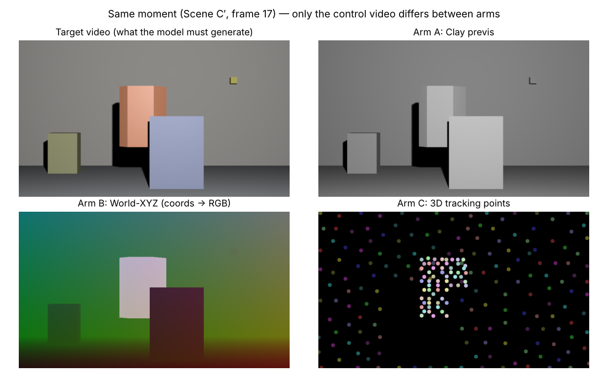
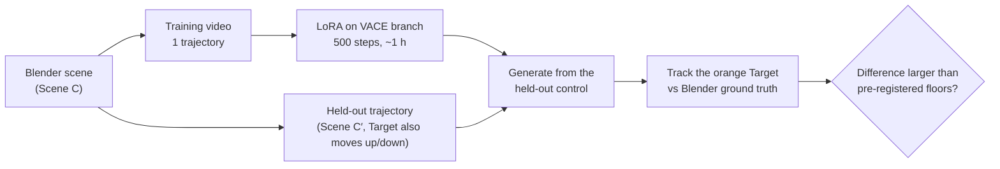
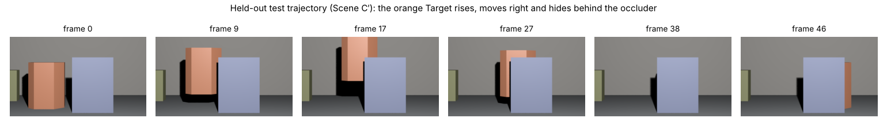
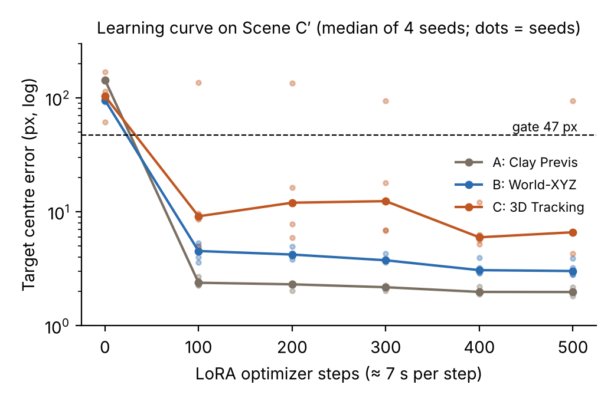
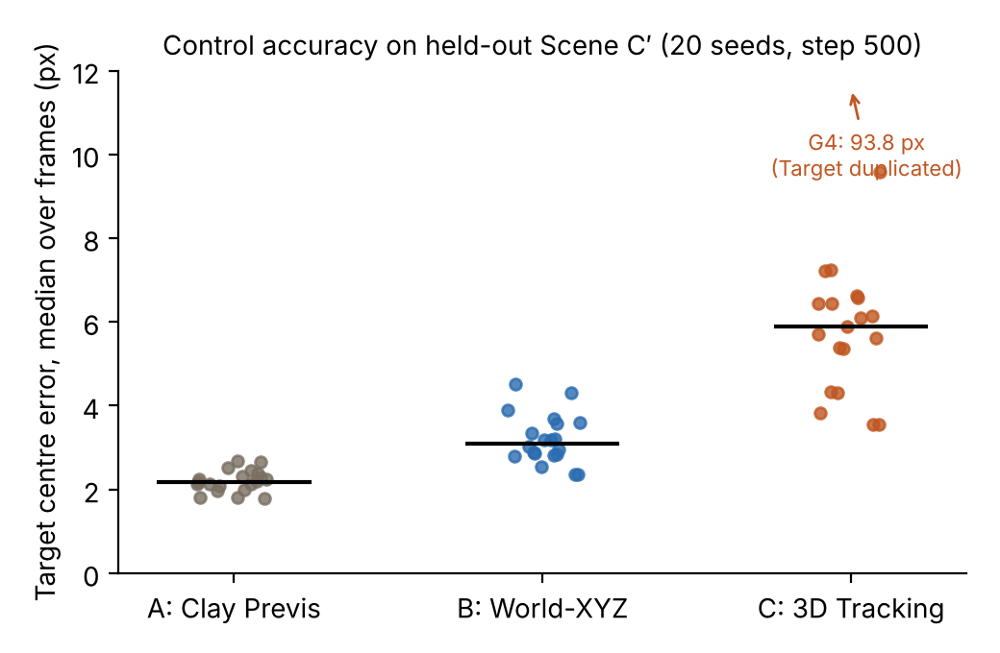
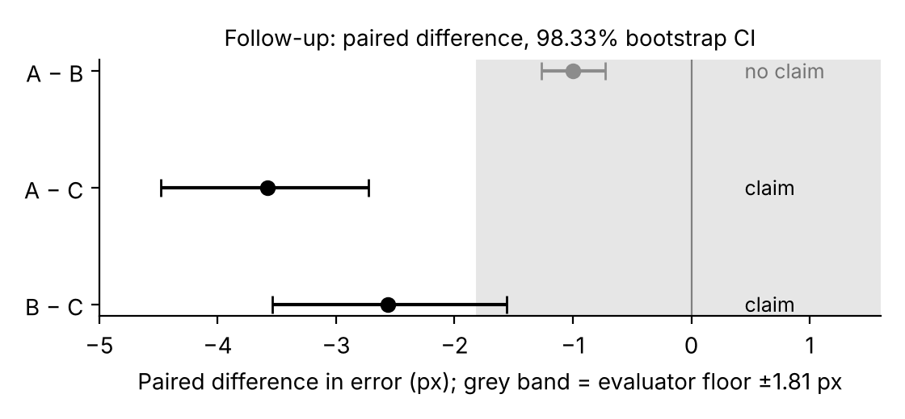
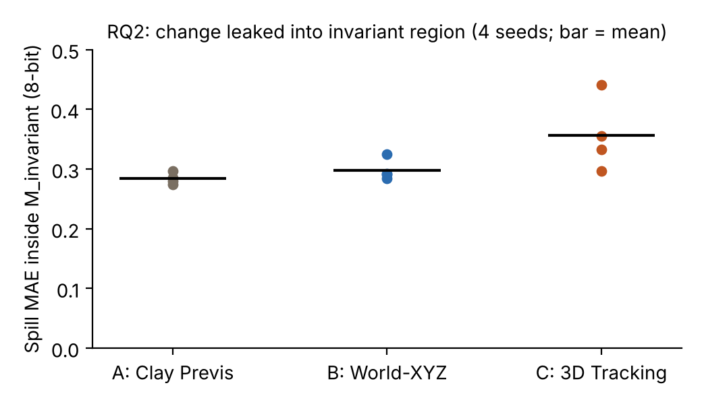
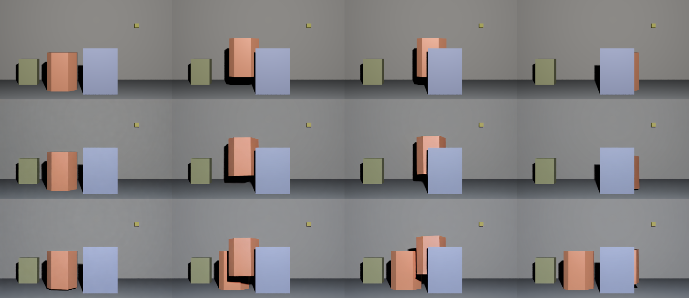

# 3D Video Control: Clay vs World-XYZ vs Tracking Points

**If you teach a video model to follow a 3D control video with a LoRA, does it matter *how* the 3D information is drawn?**

This repository compares three control representations for **Wan2.1-VACE-1.3B** under identical conditions. It contains every script, input, score file and the full thesis.

> 📄 **Thesis:** [`docs/thesis/thesis.md`](docs/thesis/thesis.md)
> 🤝 **Handoff (start here if you continue the work):** [`HANDOFF.md`](HANDOFF.md)

---

## The three representations



| Arm | Representation | What the control shows | Marks which object to move? | Density |
|---|---|---|---|---|
| **A** | Clay previs | the scene rendered in one grey material | ❌ | dense |
| **B** | World-XYZ | each pixel's 3D world coordinate packed into RGB | ✅ (separate colour band) | dense |
| **C** | 3D tracking points | 240 fixed-colour dots on object surfaces | ✅ (separate colour band) | sparse |

**Only the control video differs.** Everything else is identical across arms: prompt, reference image, resolution, LoRA settings, training video and seeds.

---

## How the experiment works



The test trajectory is **never seen in training**. A model that merely memorised the training video fails the evaluation.



**Metric.** We measure the distance (px) between the generated Target's centre and the true centre, and take the median over the 44 frames where the Target is visible. Usable means ≤ 47 px, half the Target's radius.

Every decision rule and prediction was **committed before** the corresponding videos were generated ([`docs/protocol/protocol.md`](docs/protocol/protocol.md)).

---

## Main results

### 1. All three work: no zero-shot use, usable after ~100 steps (~12 GPU-minutes)



### 2. Dense representations (A, B) are more accurate than sparse points (C)



| | A: Clay | B: World-XYZ | C: Tracking |
|---|---|---|---|
| Median error (20 seeds) | **2.2 px** | **3.1 px** | **5.9 px** |
| Catastrophic failures | 0 / 20 | 0 / 20 | 1 / 20 (Target duplicated) |



- **B vs C and A vs C: significant.** These come from a pre-registered paired bootstrap with a Bonferroni-corrected CI that excludes 0, and the differences exceed the evaluator floor.
- **A vs B: not claimed.** The difference (~1 px) is below the tracker's own error of 1.81 px.

### 3. Editing the trajectory barely disturbs the background (RQ2)



Leakage into regions that should not change is about **0.3 / 255** for every arm. No difference between arms can be claimed.

### One failure worth seeing



*Bottom row: one Arm C generation left a copy of the Target at its start position. This single video made the pre-registered primary comparison inconclusive. The pre-registered 20-seed follow-up then separated "accuracy" from "rare failure".*

| Question | Answer |
|---|---|
| Can each representation be followed after LoRA adaptation? | ✅ Yes, all three, from one training video |
| Zero-shot (no LoRA)? | ❌ None |
| Adaptation speed / GPU cost | Same for all: ~100 steps |
| Accuracy | **A ≈ B > C** |
| Edit spillover | ~0 for all, no difference |

Limitations: one scene, and one training run each for A and B. See thesis §6.

---

## Project timeline

| Phase | What | Status |
|---|---|---|
| W0–W8 (Aug 2026) | Environment, VAE survival test for Arm C, Blender scene, 3 arms × 3 splits rendered, bit-exact input pipeline, scouting run | ✅ |
| W9 | Scoring rules fixed (rev.14), Arm A/B training, 3-arm inference | ✅ |
| W10 | Floors + pre-registered Claim Gate → no claim (one Arm C failure) | ✅ |
| W11 | RQ2 spillover → tiny for all, no claim | ✅ |
| W12 | 20-seed follow-up (**A, B > C**), learning curve, zero-shot, Mask IoU | ✅ |
| W13 | Open issue #29 resolved, thesis v1.0 | ✅ |
| Next | Extensions ranked in thesis §6.2 / [`HANDOFF.md`](HANDOFF.md) | ⬜ |

---

## Folder structure

```
├─ HANDOFF.md            ★ Everything needed to continue the work
├─ CLAUDE.md             Instructions for Claude Code in this repo
├─ docs/
│  ├─ thesis/            ★ Thesis (thesis.md) + figures/
│  ├─ protocol/          ★ protocol.md (rev.18, all decisions) + rev11–18 diffs
│  ├─ worklog/           Weekly logs W0–W13, including every wrong prediction
│  └─ PRE_EXPERIMENT_SUMMARY_v1.md / PHASE_X_wan_vs_ltx_design_note.md
├─ scripts/
│  ├─ blender/           Scene construction and rendering (Blender 5.2, --factory-startup)
│  ├─ pipeline/          PNG→FFV1, metadata, GT / masks, analysis (analyze_seeds20.py, …)
│  ├─ pod/               RunPod: train_arm.sh, infer_arm.py, infer_seeds.py, score_*.py, run_*.sh
│  ├─ thesis/            make_figures.py
│  └─ vae_survival/      Phase 0.0 VAE survival test (W1)
├─ scenes/               .blend files (original / prime / edited)
├─ data/
│  ├─ inputs/            ★ Training/eval inputs (= /workspace/w4/mkv on the Pod)
│  ├─ inputs_floor/      1-px shifted controls (micro-perturbation floor)
│  ├─ inputs_rq2/        Edited controls (RQ2)
│  ├─ meta/              Training metadata jsonl (= /workspace/w4/meta)
│  ├─ points/            GT centres, masks, Arm C points, trajectories
│  ├─ render/            Rendered PNG / EXR
│  └─ reports/           Check reports and verdict tables
├─ runs/                 Training logs, generated videos (small), all score JSONs
├─ archive/              Raw tarballs from the Pod (+ md5), large ones split in 25 MB parts
└─ manifest/             md5 tables for transfer checks
```

<details>
<summary>Mapping from the original local folders (old paths in docs)</summary>

| Old | New |
|---|---|
| `SummerWork\W2\.py\` | `scripts/blender/` (only `.blend` files go to `scenes/`) |
| `SummerWork\W3\.py\` | `scripts/pipeline/` |
| `SummerWork\W4\.py\` + `W4\.gz\*.tar.gz` | `scripts/pod/` |
| `SummerWork\W1\.py\` | `scripts/vae_survival/` |
| `SummerWork\W8\pod_upload\mkv\` | `data/inputs/` |
| `SummerWork\W3\meta\` | `data/meta/` |
| `SummerWork\W2\RENDER\` | `data/render/` |
| `SummerWork\W2\.json\`, `W3\.json\` | `data/points/` / `data/reports/` |
| `SummerWork\W4\runs\`, `W4\.log\` | `runs/` |
| `SummerWork\protocol\`, `W*\.md\` | `docs/` |

Some `scripts/pipeline/` scripts import from `scripts/blender/`. Add it to `PYTHONPATH`.

</details>

<details>
<summary>Known traps (short list; full list in HANDOFF.md)</summary>

- Use `score_t_control_v2.py`. v1 builds the C′ ground truth from Scene C and is off by up to 31.9 px.
- Use `data/points/armc_prime_points_W4.json`, not `_W3.json`.
- On every new Pod, run `source /workspace/env.sh` **first**. Otherwise the system Python is used and every job fails.
- Never encode controls with H.264, even at CRF 0. Use FFV1 (`png_to_ffv1.py`).

</details>
