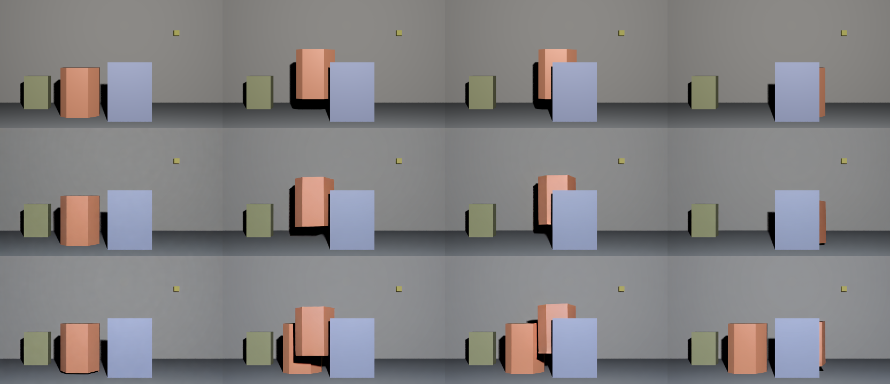
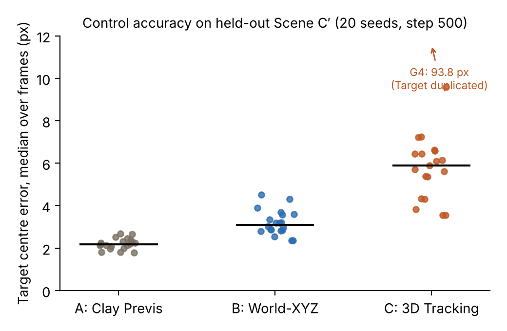
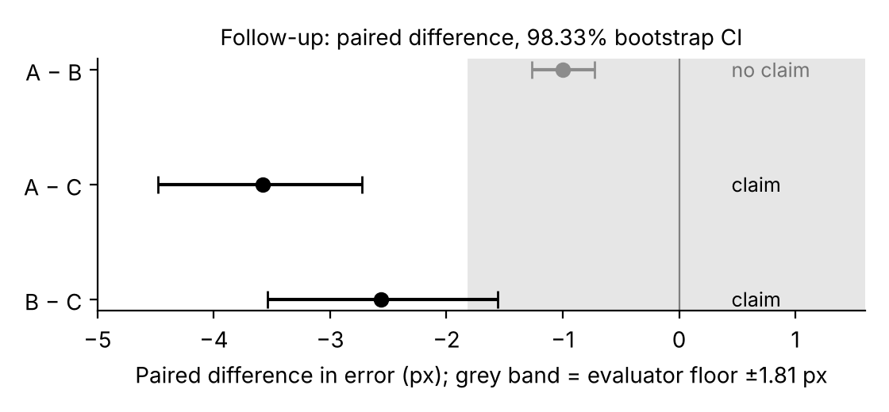
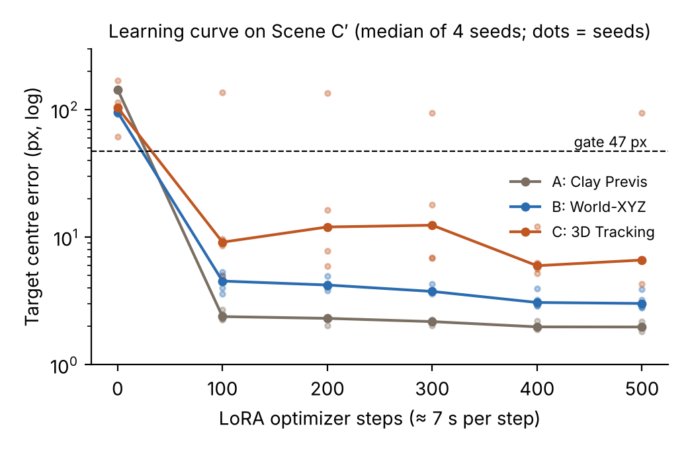
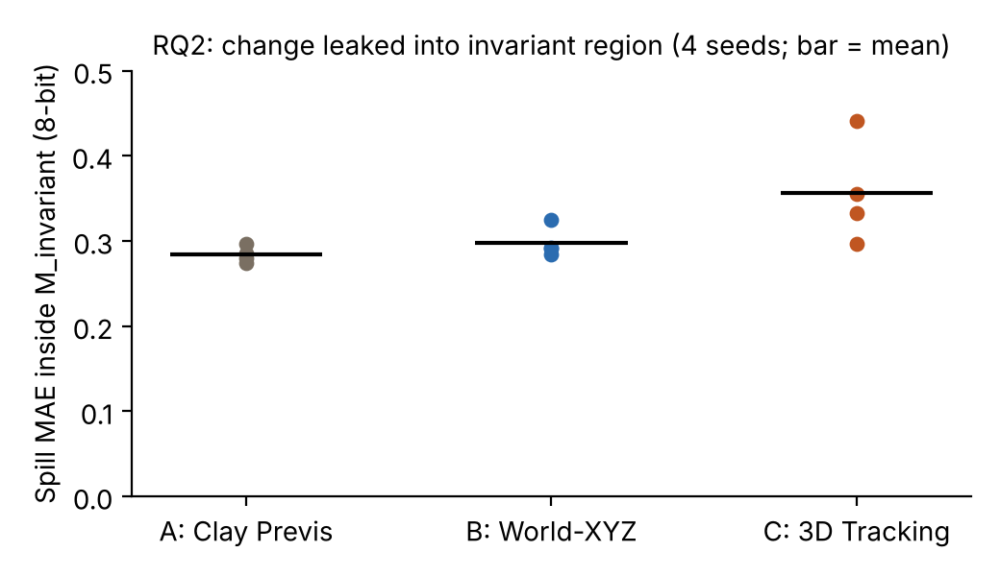

# Results and Limitations — draft v1

*Draft written 2026-11-02 from the frozen score files in this repository. Every number has a source listed in the last section. Figures are generated by `scripts/thesis/make_figures.py`.*

---

## 1. Setup in brief (context for the results)

We compare three ways of encoding a 3D control signal for **Wan2.1-VACE-1.3B**, adapted with a LoRA (rank 32) on the VACE branch only:

| Arm | Representation | Target identity in the control | Density |
|---|---|---|---|
| **A** | Clay previs (single grey material, shaded render) | not marked | dense |
| **B** | Object-aware dense world-XYZ (world coordinates packed into RGB, Target in a separate colour band) | marked | dense |
| **C** | Object-aware 3D tracking (240 fixed-colour points, radius 6 px, Target in a separate colour band) | marked | sparse |

Only the control video differs between arms. Prompt, reference image (frame 0 of the target video), resolution (832 × 480, 49 frames), LoRA settings and the training video are identical. Each arm is trained on **one** video (Scene C, original trajectory) for 500 optimizer steps. Evaluation uses a **held-out trajectory** (Scene C′, the Target additionally moves up and down), so a model that only memorised the training video cannot pass.

**Primary metric.** Target centre error: a colour tracker finds the orange Target in each generated frame, and we measure its distance to the ground-truth centroid from Blender's ID pass of Scene C′. We take the median over the 44 frames in which the Target is visible. Gate: median ≤ 47 px (half the Target's equivalent radius of 94.5 px).

All analysis rules and predictions were frozen in `docs/protocol/protocol.md` before the corresponding generations were run (§41–§45).

---

## 2. Results

### 2.1 Pipeline checks

| Check | Result |
|---|---|
| Control encoding (PNG → FFV1 → model input) | bit-identical for all controls |
| Regenerating a video with the same LoRA, control and seed | **bit-identical** (all three arms; also when generating several seeds in one process) |
| Re-saving the control | pixels unchanged |
| Evaluator floor: tracker applied to the ground-truth video of Scene C′ | median 1.81 px, p95 3.75 px |
| Scoring re-implemented independently (scipy vs. numpy labelling) | identical on every frame of every video |

Generation is therefore deterministic given the seed, and the evaluator is accurate to about 2 px.

### 2.2 All three representations learn to follow the control

After 500 steps, every arm passes the gate on the held-out trajectory, and each output is closer to the new trajectory than to the training trajectory (seed G1: A 1.98 vs 46.68 px, B 3.89 vs 53.02 px, C 6.62 vs 57.47 px). The model reads the control; it does not replay the training video.

### 2.3 RQ1, pre-registered primary analysis: no claim

The primary Claim Gate (§42) used four generation seeds per arm and required the difference between arms to exceed every measured floor.

| Floor | Value (px) |
|---|---|
| Determinism (regenerate) | 0.00 |
| Encoding (re-save control) | 0.00 |
| Micro-perturbation (shift control by 1 px) | 0.10 |
| Seed variability (max over arms) | **89.52** (Arm C) |
| Training-run variability (Arm C, 3 runs) | 1.79 |
| Evaluator | 1.81 |

Arm means over seeds G1–G4 were A 1.98, B 3.18, C 27.83 px. **No pair exceeded the largest floor**, so under the pre-registered rule we could not claim a difference.

The seed floor was dominated by one generation. With seed G4, Arm C produced a **duplicate Target** that stayed at the start position while the real one followed the control (Fig. 5). After the real Target moved behind the occluder, the tracker locked onto the duplicate and the error jumped to 93.8 px. This is a failure of the generated video, not of the tracker, which correctly reported two components.

*Fig. 5. Frames 0 / 10 / 25 / 45. Top: Scene C′ ground truth. Middle: Arm C, seed G1. Bottom: Arm C, seed G4, where a duplicate Target remains at the start position.*

### 2.4 RQ1, pre-registered follow-up (20 seeds): A and B are more accurate than C

The primary rule mixed two questions: how accurate a representation is when it works, and how often it fails catastrophically. Before generating any new videos, we registered a follow-up (§44) that separates them and raises the number of generation seeds to 20 per arm.

- **Accuracy:** differences paired by seed, using only seeds where neither arm failed. 98.33% bootstrap CI (Bonferroni over three pairs). A claim also requires at least 10 seeds and a mean difference above the evaluator floor (1.81 px).
- **Stability:** number of catastrophic failures (median error > 47 px), Fisher's exact test at α = 0.05/3.

| | A | B | C |
|---|---|---|---|
| Median error, non-failed seeds (px) | **2.18** | **3.10** | **5.89** |
| Catastrophic failures | 0 / 20 | 0 / 20 | 1 / 20 |

| Pair | Mean paired difference (px) | 98.33% CI | Decision |
|---|---|---|---|
| **B − C** (primary) | −2.56 | [−3.54, −1.56] | **claim: B more accurate** |
| A − C | −3.58 | [−4.48, −2.73] | **claim: A more accurate** |
| A − B | −1.00 | [−1.27, −0.73] | no claim (below evaluator floor) |
| Stability, all pairs | — | Fisher p = 1.0 | no claim |

*Fig. 1. Per-seed error on Scene C′ (20 seeds). Bars are medians of non-failed seeds.*

*Fig. 2. Paired differences with Bonferroni-corrected bootstrap intervals. The grey band is the evaluator floor.*

As a descriptive check (not part of the frozen rule), B beat C on 17 of 19 paired seeds and A beat C on 19 of 19. A beat B on 19 of 20 seeds, but the difference (1.0 px) is smaller than the evaluator's own error, so we do not interpret it.

The catastrophic failure seen in §2.3 did not recur in the 16 new seeds of Arm C (1 / 20 overall).

### 2.5 RQ1, adaptation: no zero-shot use, all arms usable after about 12 GPU-minutes

Using the checkpoints saved during training (§45, four seeds each, report only):

| Arm | Step 0 (no LoRA) | 100 | 200 | 300 | 400 | 500 |
|---|---|---|---|---|---|---|
| A | 143.3 | **2.4** | 2.3 | 2.2 | 2.0 | 2.0 |
| B | 95.3 | **4.5** | 4.2 | 3.8 | 3.1 | 3.0 |
| C | 103.5 | **9.1** | 12.0 | 12.4 | 6.0 | 6.6 |

*Median error (px) over four seeds.*

*Fig. 3. Learning curve on Scene C′. Lines show medians; dots show individual seeds. The dashed line is the 47 px gate.*

- **Zero-shot compatibility: none.** Without the LoRA, all arms fail by a wide margin, and almost no frame contains exactly one Target.
- **Adaptation speed: no visible difference.** All three arms pass the gate by step 100, the first saved checkpoint, which is about 12 minutes on one RTX PRO 6000 Blackwell.
- From step 100 onwards the ordering A < B < C holds at every checkpoint. Arm C is the only arm whose error is not monotone in training steps.

### 2.6 Exploratory: Target mask overlap

The IoU between the generated Target mask and the ground-truth mask (median over visible frames; 20 seeds; ceiling 0.968 for the ground-truth video itself) was A 0.953, B 0.937, C 0.875. The ordering matches the centre-error results. This metric was added after the step-500 videos had been scored, so it is reported as exploratory only.

### 2.7 RQ2: edits are realised and barely leak

We generated each arm from the original control and from the edited control (the Target stops at frames 12–23 and catches up at 24–35) with the same seed, using seeds G1–G4. We then measured how much the two videos differ inside **M_invariant**: pixels that, in Blender, show the same non-Target surface in both versions (95.07% of the frame).

| | A | B | C |
|---|---|---|---|
| Spill MAE in M_invariant (8-bit, mean of 4 seeds) | 0.284 | 0.298 | 0.357 |
| Seed range | 0.022 | 0.040 | 0.144 |
| Edit realised: error to the edited trajectory (median, px) | 3.5–3.8 | 2.6–3.0 | 2.4–5.4 |

*Fig. 4. Change leaked into the invariant region, per seed.*

- **All arms realise the edit.** The edited and original trajectories differ by up to 53 px, and each arm follows the edited one to within a few pixels.
- **Leakage is tiny for all arms.** It is about 0.3 out of 255, and the 95th percentile of the per-pixel difference is 1.
- **Under the pre-registered rule (§43), no pair can be claimed.** Arm C's seed range (0.144) exceeds every between-arm difference (at most 0.073).
- The edit signal in the control also differs by arm. The changed area is A 3.20%, B 2.33%, C 1.65%, and the mean change is largest for C. Any spillover ordering could therefore partly reflect the input rather than the representation.

---

## 3. Summary of findings

| Question | Answer | Status |
|---|---|---|
| Do all three representations let the model follow a held-out trajectory? | Yes, after 500 (already after 100) steps | Observed for every arm and seed (except one Arm C failure) |
| Zero-shot compatibility | None for any arm | Report only (4 seeds) |
| Adaptation speed / GPU cost to the gate | No difference; about 12 GPU-minutes for all | Report only |
| Accuracy after adaptation | **A and B are more accurate than C** | Pre-registered follow-up, significant |
| A vs B | A slightly better (about 1 px), below evaluator resolution | No claim |
| Catastrophic failures | C 1 / 20, A and B 0 / 20 | No claim (low power) |
| Leakage of an object edit into invariant regions | About 0.3 / 255 for all arms | No claim |

---

## 4. Limitations

1. **One scene, one training video.** All results come from Scene C (training) and its trajectory variant C′ (test). We make no claim about representations in general, only about adapting Wan2.1-VACE-1.3B to this setting.
2. **Training-run variability measured for Arm C only.** Arm C was trained three times (errors 6.62 / 8.41 / 7.51 px at seed G1, all worse than any seed of Arm B). Arms A and B were trained once each, so the follow-up's significance is with respect to generation noise of one trained LoRA per arm.
3. **The follow-up was designed after seeing the primary result.** Its rules and predictions were frozen before any new video was generated, and the primary null result is reported alongside it.
4. **Evaluator resolution.** The colour tracker has a median error of 1.81 px on ground-truth video, which limits how small a difference we can interpret (A vs B).
5. **Metric scope.** Only the centre error is used as a gate. Mask IoU is exploratory. LPIPS, SSIM and DINO features for spillover were not measured. The control's edit signal was compared in pixel space, not in VAE latent space.
6. **RQ2 uses four seeds**, and the seed range of Arm C dominates. More seeds might resolve the ordering.
7. **Single GPU type** (RTX PRO 6000 Blackwell). Results are deterministic on this hardware. Cross-GPU numerical variation was not measured in this study.
8. **Arm C point density and radius** (240 points, 6 px) were chosen for VAE survival. A different density could change its accuracy.

---

## 5. Deviations from the original protocol (to report)

| When | Change | Why | Before or after seeing affected results |
|---|---|---|---|
| rev.14 | GT centre taken from the C′ ID pass instead of the Scene C mask shifted by dZ | Old GT was off by up to 31.9 px | Before Arm A/B results (scouting-run Arm C was re-scored) |
| rev.14 | Coherence gate counts frames (≤ 2) instead of a rate | Tracker failures shrank the denominator | Before Arm A/B results |
| rev.15 | Representative arm for training variability = Arm C | Already representative arm in the scouting run | After Phase 0.8 results, reason independent of them |
| rev.17 | 20-seed follow-up separating accuracy and stability | Primary rule mixed both | After primary result; before new generations |
| rev.18 | Learning curve, zero-shot, Mask IoU | RQ1 items not yet measured | Before curve generations; IoU after step-500 scoring (exploratory) |

---

## 6. Sources of numbers

| Section | File |
|---|---|
| 2.1 | `docs/protocol/protocol.md` §36.6, §41.4; `docs/worklog/worklog_W9_2026-11-01.md`; `runs/phase4/phase4.log` |
| 2.2 | `runs/phase08/gen/score_arm*.json` |
| 2.3 | `docs/worklog/worklog_W10_2026-11-01.md`; `runs/phase4/gen/*.score.json` |
| 2.4 | `data/reports/w12_seeds20_verdict.md`; `runs/seeds20/gen/seeds20/*.json` |
| 2.5 | `runs/curve/gen/curve/*.json` |
| 2.6 | `runs/curve/iou_seeds20.csv` |
| 2.7 | `runs/rq2/gen/rq2_*.json`; `docs/protocol/protocol.md` §43.3 |
