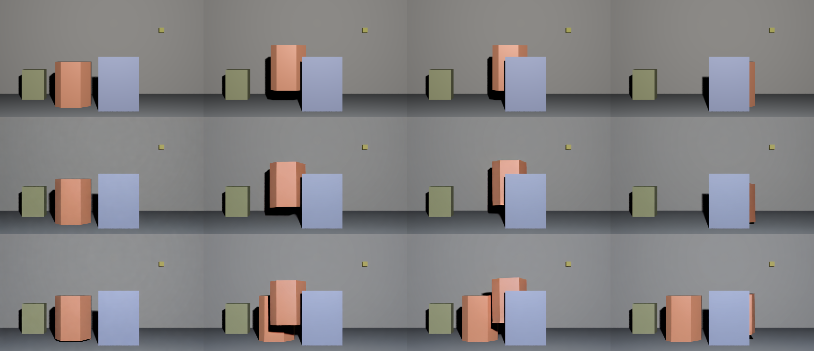
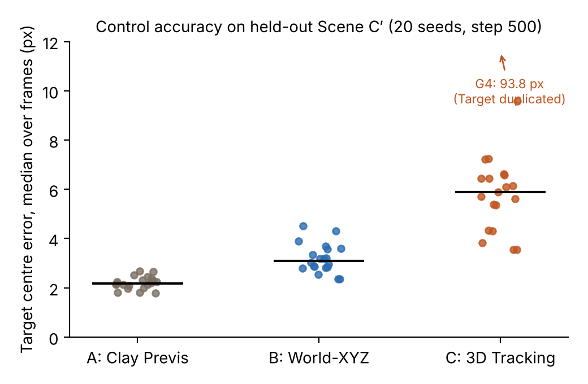
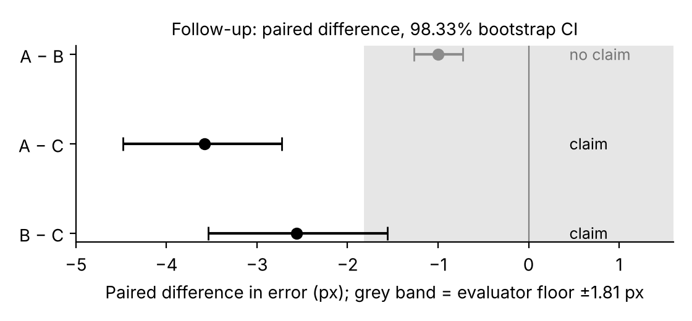
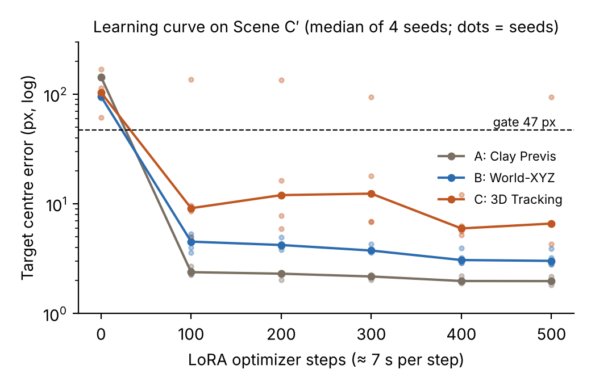
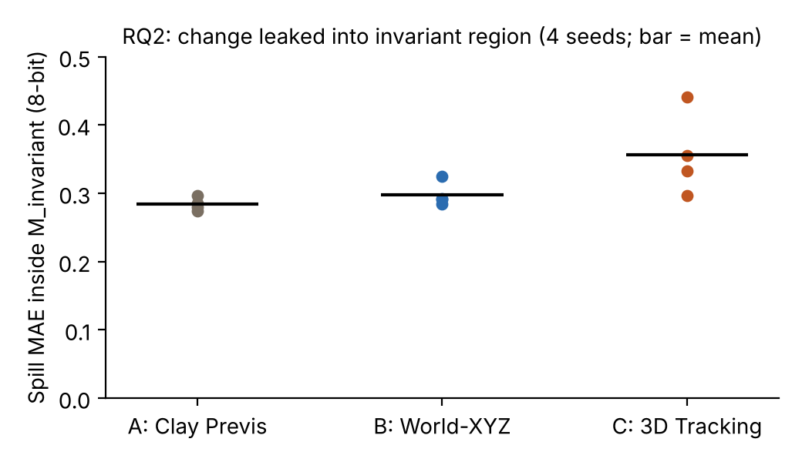

# Clay, World-XYZ or Tracking Points? Comparing 3D Control Representations for LoRA Adaptation of a Video Diffusion Model

**Taro Kinoshita**
Bachelor's thesis, Artificial Intelligence, Radboud University
Version 1.0, November 2026

---

## Abstract

Video diffusion models can be steered with a control video, but it is unclear which encoding of 3D scene information such a model learns to use most effectively. We compare three control representations for **Wan2.1-VACE-1.3B**, adapted with a rank-32 LoRA on the VACE context branch only:

- **(A) Clay previs:** a shaded, single-material render
- **(B) Object-aware dense world-XYZ:** world coordinates packed into RGB, with a separate colour band for the target object
- **(C) Object-aware 3D tracking:** 240 fixed-colour surface points

Everything except the control video is held constant. Each representation is trained on a single synthetic Blender video and evaluated on a held-out trajectory, so that memorisation of the training video cannot pass the evaluation.

All analysis rules and predictions were pre-registered before the corresponding videos were generated.

**Results.**
- All three representations taught the model to follow the held-out trajectory. None worked zero-shot, and all reached the usability gate after about 100 optimisation steps (about 12 GPU-minutes).
- Our pre-registered primary comparison (four generation seeds) could not separate the arms. A single generation of the tracking arm duplicated the target object and dominated the seed-variability floor.
- A pre-registered follow-up with 20 seeds separated accuracy from catastrophic failure. It showed that **clay (median error 2.2 px) and world-XYZ (3.1 px) are both more accurate than tracking points (5.9 px)**, with Bonferroni-corrected paired bootstrap intervals excluding zero.
- Clay and world-XYZ could not be distinguished beyond the evaluator's resolution.
- An object-trajectory edit was realised by all arms. It leaked only about 0.3/255 into regions that should not change, with no claimable difference between arms.

These results hold for one scene and one trained adapter per dense arm. We discuss which extensions would most strengthen them.

---

## 1. Introduction

Controllable video generation conditions a pretrained video diffusion model on an additional signal: depth maps, edges, poses, or arbitrary videos. The signal specifies structure and motion, while the model supplies appearance.

When the control has to carry **3D** information (where an object is in the scene and how it moves), there are several ways to draw that information as a video:

1. **Render the scene in a neutral material.** This is "clay" or previs. Shape and shading carry the 3D layout implicitly.
2. **Write the 3D coordinates of every visible surface point into the pixel colours.** This is a dense world-XYZ map.
3. **Draw a sparse set of tracked 3D points with fixed identities.** These are tracking points.

These representations differ in density, in whether they carry appearance, and in whether they mark which object should be edited. They also differ in how well they survive the model's video VAE: sparse coloured dots are vulnerable to temporal compression.

We ask two research questions, restricted to one model and one adaptation method:

- **RQ1 (adaptation).** How do the three representations differ in zero-shot compatibility, adaptation speed, the GPU cost to reach a common usability threshold, and the control accuracy after adaptation?
- **RQ2 (edit spillover).** When the target object's trajectory is changed counterfactually, how well does each representation realise the edit, and how much change leaks into regions that the edit should leave untouched?

We do **not** claim general superiority of a representation. All claims are limited to adapting Wan2.1-VACE-1.3B with a LoRA in the setting described below.

**Contributions.**

1. A controlled comparison in which only the control video differs between conditions, with bit-exact verification of the whole input path.
2. A held-out-trajectory evaluation that distinguishes reading the control from replaying the training video.
3. Pre-registered decision rules (floors, gates, predictions) applied before each set of generations, including an honest null primary result and a pre-registered follow-up.
4. Evidence that dense representations (clay, world-XYZ) yield more accurate control than sparse tracking points, while all three adapt within minutes.

---

## 2. Background

**Video diffusion and VACE.** Wan2.1 is an open family of video diffusion transformers trained with a causal video VAE that compresses time by 4 and space by 8 (Wan Team, 2025). VACE adds a context branch that receives control videos, masks and reference images, and injects them into the main transformer (Jiang et al., 2025). Because the context branch is separate, it can be adapted on its own. That allows us to measure the cost of learning to *read* a control without retraining the generator.

**LoRA.** Low-rank adaptation trains small rank-r updates to selected weight matrices (Hu et al., 2022). We apply it only to the attention and feed-forward projections of the VACE branch. The resulting adapter is 44 MB, consistent with adapting the context branch alone.

**3D control representations.** Depth and normal maps are common structural controls. However, depth from a single viewpoint cannot convey camera motion in rotationally symmetric scenes, which motivated this study. Our three representations sit at different points between appearance-rich, label-free renders (clay) and appearance-free, object-labelled geometric codes (world-XYZ, tracking points). Tracking points, in addition, give explicit temporal correspondence through fixed colours.

**Evaluation practice.** Small differences between conditions in generative models are easily within run-to-run noise. Following the idea of a "claim gate", we only claim a difference when it exceeds measured floors: determinism, encoding, micro-perturbation, seed variability, training-run variability and evaluator error.

---

## 3. Methods

### 3.1 Scene and trajectories

All data are rendered in Blender 5.2.0 with EEVEE. The camera is fixed (50 mm lens, 36 mm sensor, 832 × 480, 16 fps, 49 frames). Scene C contains:

- A wall, a floor and a non-target block
- A small asymmetric marker, used to detect image flips
- An occluder plate
- The **Target**: an orange hexagonal prism, 1.10 × 0.80 × 1.40 units, with two asymmetric bevels

The scene has four trajectories:

| Name | Use | Target motion |
|---|---|---|
| **Scene C (original)** | training | X from −0.90 to +0.90 at constant speed; fully occluded at frames 36–40 |
| **Scene C (edited)** | RQ2 counterfactual | same, but stops at frames 12–23 and catches up at 24–35; identical again from frame 36 |
| **Scene C′ (prime)** | held-out test | same X as original, plus a vertical raised-cosine dZ (peak 0.848 units at frames 17–18, zero from frame 35) |

Scene C′ satisfies four constraints:

1. Screen speed of at most 12 px/frame (measured maximum 11.40)
2. Same Target screen area, because depth is unchanged
3. Identical frame 0, so all conditions share one reference image
4. The same full-occlusion window, frames 36–40

### 3.2 Control representations

All controls are rendered from the same scene and animation. Only the encoding differs.

- **Arm A (clay).** Every object uses one grey material (base colour 0.5, roughness 0.6). It is rendered with EEVEE, with ray tracing off for determinism. The control contains no object labels. A balanced-accuracy check confirmed that Target and non-Target pixels are not separable by brightness (maximum 0.87 < 0.99).
- **Arm B (world-XYZ).** The EEVEE position pass is normalised to a fixed scene box. X, Y, Z go to R, G, B, mapped into 13–115 for non-target pixels and 140–242 for Target pixels, with the band 124–131 reserved. The position pass is used directly, without depth back-projection.
- **Arm C (tracking points).**
  - 240 surface points: 72 on the Target and 168 elsewhere.
  - Points are selected by farthest-point sampling over both trajectory variants, with a minimum separation of 13.4 px.
  - They are coloured from a 12-colour palette with at least 48.1 RGB distance between neighbours, drawn as 6 px discs, and painted far to near.
  - Visibility comes from ray casting.
  - Radius and count were chosen in a VAE round-trip study. The worst colour error was 4.27 against a criterion of 24.

Controls are stored losslessly as FFV1 RGB video. We verified that the full input path (PNG → FFV1 → decoding → resizing → dataset → model) is **bit-identical**. Lossy H.264, even at CRF 0, changed 39.5% of pixels by ±1, which is enough to move world-XYZ coordinates by up to 14 px.

### 3.3 Model, adaptation and inference

| Setting | Value |
|---|---|
| Base model | Wan2.1-VACE-1.3B (DiffSynth-Studio 2.0.18) |
| Adapted module | VACE branch only, LoRA rank 32 (α = rank), targets q, k, v, o, ffn.0, ffn.2 |
| Training data | one video: Scene C original target video + the arm's control + reference image (target frame 0) |
| Prompt | identical for all arms; describes appearance only, not motion |
| Optimisation | AdamW, lr 1e-4 (first 5 steps at 1/3, framework default), weight decay 0.01, batch 1, 500 steps, gradient checkpointing |
| Hardware | one RTX PRO 6000 Blackwell (96 GB); about 7 s per step; peak memory 30.1 GB |
| Inference | 50 steps, CFG 5.0, sigma shift 5.0, empty negative prompt, 49 frames, untiled VAE; seeds G1–G20 = 0–19 |

The LoRA is fused into the VACE branch at load time. We checked that 150 tensors were fused in every run, which guards against silently generating with the base model.

### 3.4 Evaluation

**Target centre error.**
- A colour segmentation (R > G ≥ B, R − B > 40, R > 80) finds orange pixels.
- Components near the fixed marker are excluded.
- The centroid of the largest remaining component is compared with the centroid of the Target in Blender's ID pass for the same frame.
- The per-video score is the median over the 44 frames in which the Target is visible in the ground truth.

**Gates.**
- **Control:** median ≤ 47 px, half the Target's equivalent radius of 94.5 px. At that offset, two discs still overlap with IoU ≈ 0.52.
- **Coherence:** at most 2 visible frames in which the number of Target components differs from one. Frames without any detection are counted separately.

**Evaluator floor.**
Applied to the ground-truth Scene C′ video, the tracker has a median error of 1.81 px (p95 3.75 px).

*Correction made before the arm comparison.*
- An earlier evaluator built the C′ ground truth by shifting the Scene C centroid. Because the Target rises above the occluder in C′, its visible silhouette differs from Scene C, and that shortcut was off by up to 31.9 px.
- We replaced it with the C′ ID pass before any result for Arms A or B existed.

**Memorisation check.**
For each generation, we also compute the error with respect to the training trajectory. A generation that follows the control is closer to C′ than to C.

**Spillover (RQ2).**
- For each arm and seed, we generate once from the original control and once from the edited control.
- Spill MAE is the mean absolute 8-bit difference between the two generations inside **M_invariant**. This is the set of pixels that, in Blender, show the same non-Target surface at the same depth in both variants, more than 2 px from the Target silhouette, with ground-truth difference ≤ 2.
- It covers 95.07% of each frame over frames 13–35. We report PSNR, the 95th percentile and the error to the edited trajectory alongside.

### 3.5 Decision rules

**Floors (protocol §42).**
- Determinism: regenerate with an identical seed.
- Encoding: re-save the control.
- Micro-perturbation: shift the control 1 px to the right.
- Seed variability: range over seeds G1–G4.
- Training-run variability: three training runs of a representative arm, Arm C, chosen before any comparison because it was the scouting arm.
- Evaluator floor.

**Primary rule (§42).** The arm value is the mean of the four seed medians. A pair difference is claimed only if it exceeds the largest floor.

**Follow-up rule (§44).** Seeds were extended to 20 per arm, and two questions were separated:

- **Accuracy.** Use the seeds in which neither arm failed (failure = median > 47 px). Take paired differences by seed. Claim only if all three hold:
  - at least 10 seeds
  - the 98.33% percentile bootstrap interval (10,000 resamples; Bonferroni over three pairs) excludes zero
  - |mean difference| > 1.81 px
- **Stability.** Compare failure counts with Fisher's exact test at α = 0.05/3.

Pairs were fixed in advance: **B vs C** (primary), A vs B and A vs C.

**Learning curve (§45).** The saved checkpoints at steps 100–400, plus no LoRA, were evaluated with four seeds. This analysis is **report-only**.

**RQ2 (§43).** The rule has the same form as the primary rule, applied to spill MAE.

Every rule and every set of predictions was committed to the repository before the generations it applied to.

---

## 4. Results

### 4.1 Pipeline checks

| Check | Result |
|---|---|
| Control input path | bit-identical for all controls |
| Regenerating with the same LoRA, control and seed | bit-identical for all three arms (also when generating many seeds in one process) |
| Re-saving the control | pixels unchanged (encoding floor = 0) |
| Evaluator on ground-truth C′ | median 1.81 px, p95 3.75 px |
| Independent re-implementation of scoring | identical on every frame of every video |

### 4.2 All representations learn to read the control

After 500 steps, every arm passes both gates on the held-out trajectory. Each output is much closer to the new trajectory than to the training trajectory (seed G1):

| Arm | Error to C′ trajectory | Error to C trajectory |
|---|---|---|
| A | 1.98 | 46.68 |
| B | 3.89 | 53.02 |
| C | 6.62 | 57.47 |

The adapters read the control rather than replaying the training video. This contradicts our own pre-study prediction that a single training video would lead to memorisation.

### 4.3 RQ1, pre-registered primary analysis: no claim

| Floor | Value (px) |
|---|---|
| Determinism | 0.00 |
| Encoding | 0.00 |
| Micro-perturbation | 0.10 |
| Seed variability (max over arms) | **89.52** (Arm C) |
| Training-run variability (Arm C) | 1.79 |
| Evaluator | 1.81 |

Arm values (mean over G1–G4) were A 1.98, B 3.18 and C 27.83 px. **No pair exceeded the largest floor.**

The seed floor was dominated by one generation. With seed G4, Arm C produced a **duplicate Target** that stayed at the start position while the real one followed the control (Fig. 5). Once the real Target moved behind the occluder, the tracker locked onto the duplicate and the error rose to 93.8 px. The tracker behaved correctly: it reported two components.

*Fig. 5. Frames 0 / 10 / 25 / 45. Top: Scene C′ ground truth. Middle: Arm C, G1. Bottom: Arm C, G4, where a duplicate Target remains at the start position.*

### 4.4 RQ1, pre-registered follow-up: dense representations are more accurate

| | A | B | C |
|---|---|---|---|
| Median error, non-failed seeds (px) | **2.18** | **3.10** | **5.89** |
| Catastrophic failures | 0 / 20 | 0 / 20 | 1 / 20 |

| Pair | Mean paired difference (px) | 98.33% CI | Decision |
|---|---|---|---|
| **B − C** (primary) | −2.56 | [−3.54, −1.56] | **claim: B more accurate** |
| A − C | −3.58 | [−4.48, −2.73] | **claim: A more accurate** |
| A − B | −1.00 | [−1.27, −0.73] | no claim (below evaluator floor) |
| Stability, all pairs | — | Fisher p = 1.0 | no claim |

*Fig. 1. Per-seed error on Scene C′ (20 seeds). Bars are medians of non-failed seeds.*

*Fig. 2. Paired differences with Bonferroni-corrected bootstrap intervals; grey band = evaluator floor.*

As a descriptive check outside the frozen rule:

- B beat C on 17 of 19 paired seeds, and A beat C on 19 of 19.
- A beat B on 19 of 20 seeds, but by about 1 px, which is below the evaluator's resolution.
- The duplication failure of Arm C did not recur in its 16 new seeds.

All five pre-registered predictions for this analysis were checked. Four were correct. The wrong one overestimated Arm C's failure rate: we predicted 2–6 failures in 20 and observed 1.

### 4.5 RQ1, adaptation speed and zero-shot compatibility

| Arm | Step 0 (no LoRA) | 100 | 200 | 300 | 400 | 500 |
|---|---|---|---|---|---|---|
| A | 143.3 | **2.4** | 2.3 | 2.2 | 2.0 | 2.0 |
| B | 95.3 | **4.5** | 4.2 | 3.8 | 3.1 | 3.0 |
| C | 103.5 | **9.1** | 12.0 | 12.4 | 6.0 | 6.6 |

*Median error (px) over four seeds; report-only.*

*Fig. 3. Learning curve on Scene C′. Lines are medians of four seeds; dots are seeds; the dashed line is the 47 px gate.*

- **No representation is usable zero-shot.** Without the adapter, outputs fail the gate by a wide margin, and almost no frame contains exactly one Target.
- **All representations pass the gate at step 100**, the first checkpoint, which is about 12 GPU-minutes. Adaptation speed and GPU cost to the gate are therefore indistinguishable at this resolution.
- From step 100 onwards, the ordering A < B < C holds at every checkpoint. Only Arm C is non-monotone in training steps.

### 4.6 Exploratory: Target mask overlap

The IoU between the generated and ground-truth Target masks (median over visible frames; 20 seeds) was:

| A | B | C | Ceiling (ground-truth video) |
|---|---|---|---|
| 0.953 | 0.937 | 0.875 | 0.968 |

The ordering agrees with the centre error. This metric was added after the step-500 videos were scored and is exploratory.

### 4.7 What the coherence gate actually counts

Across the 28 generated videos available locally, 76 visible frames contained more than one orange component.

- In 73 of them, the second component was either tiny or very large. The remaining 3 lie between those sizes and all come from the same failed video.
- **All 33 frames with a large second component (≥ 1,000 px) came from the single duplicating generation (Arm C, G4).**
- **The other 40 frames had a second component of at most 56 px.** These are slivers of the Target split by the occluder edge, concentrated at frames 34 and 41, where the visible Target is a thin strip.

The ground-truth mask is a single component in those frames, and the tracker reports a single component on the ground-truth video. Coherence-gate failures in this study are therefore, apart from the one duplication, a limitation of the colour segmentation and not failures of generation. The coherence gate as defined overstates incoherence. We did not change it after the fact; a size threshold is proposed in §6.

### 4.8 RQ2: edits are realised and barely leak

| | A | B | C |
|---|---|---|---|
| Spill MAE in M_invariant (8-bit; mean of 4 seeds) | 0.284 | 0.298 | 0.357 |
| Seed range | 0.022 | 0.040 | 0.144 |
| Error to the edited trajectory (median, px) | 3.5–3.8 | 2.6–3.0 | 2.4–5.4 |

*Fig. 4. Change leaked into the invariant region, per seed.*

- **All arms realise the edit.** The edited and original trajectories differ by up to 53 px, and each arm follows the edited one within a few pixels.
- **Leakage is about 0.3 / 255** for every arm, with a per-pixel 95th percentile of 1.
- Arm C's seed range exceeds every between-arm difference, so **no pair can be claimed**.

The input edit signal also differs by arm: the changed control area is A 3.20%, B 2.33%, C 1.65%, and the mean change is largest for C. Any ordering could partly reflect the input rather than the representation.

---

## 5. Discussion

**Dense versus sparse.**
- Both dense representations gave the most accurate control.
- Tracking points were about 2.5–3.5 px less accurate. They were the only representation whose accuracy was non-monotone during training and the only one to produce a duplication failure.
- A plausible explanation follows from the VAE study. Sparse points lose colour under temporal compression, and between points the model has no information about the object's extent. A dense encoding constrains every Target pixel.
- Tracking points did not *fail* to convey motion, however. They were usable after the same 100 steps as the dense codes.

**Clay versus world-XYZ.**
- Clay has no explicit object label, yet it was at least as accurate as world-XYZ (about 1 px better on 19 of 20 seeds).
- In this scene the Target is the only moving object and the reference image shows it in colour. The model may identify the Target by motion and appearance rather than by a label.
- Explicit labels and explicit coordinates may matter more in scenes with several moving objects or with depth motion. Clay conveys depth only through shading and scale.

**Speed of adaptation.** A single training video and 100 optimiser steps sufficed for every representation, contrary to our own expectation of memorisation. For a practitioner, the cost of adopting any of these representations with VACE is minutes of GPU time. The choice between them should be based on accuracy and on what the control needs to express, not on training cost.

**Spillover.** Object-trajectory edits barely affected the static background for any representation. In a fixed-camera scene, the background is reproduced almost exactly. Spillover is therefore not a discriminating property at this scale. A harder setting (moving camera, interacting objects) would be needed.

**On pre-registration.**
- The primary analysis was null because one catastrophic generation set the floor for everything.
- Separating "how accurate when it works" from "how often it fails", and registering that split before collecting more data, turned an uninformative result into an informative one without changing any number after the fact.
- The cost is that the significant result is a follow-up, and we report both.

---

## 6. Limitations and extension priorities

### 6.1 Limitations

1. **One scene, one training video.** No claim is made about representations in general.
2. **Training-run variability was measured only for Arm C.** Its three runs scored 6.62, 8.41 and 7.51 px at G1, all worse than any seed of Arm B. Arms A and B were trained once each, so the follow-up is significant with respect to generation noise of one adapter per dense arm.
3. **The follow-up was designed after seeing the primary result.** Its rules and predictions were frozen before any new video was generated.
4. **Evaluator resolution and scope.** The tracker's median error is 1.81 px, which limits the A–B comparison. Its colour segmentation fragments thin Target slivers (§4.7). Only the centre error is a gate. LPIPS, SSIM and DINO features were not measured.
5. **RQ2 used four seeds**, and the edit signal was compared in pixel space, not in VAE latent space.
6. **Single GPU type.** Results are bit-exact on this hardware. Cross-hardware variation was not measured in this study.
7. **Arm C design choices** (240 points, 6 px radius) were tuned for VAE survival. A different density could change its accuracy.
8. **Scene simplicity.** One moving object, fixed camera, diffuse materials. The renderer-shift split (EEVEE vs Cycles) reduced to an exposure change and was not evaluated.

### 6.2 Extension priorities

Ordered by expected value per cost. All costs assume the same GPU type (≈ $2.09/h).

| Priority | Extension | Removes limitation | GPU | Cost | Needs |
|---|---|---|---|---|---|
| **1** | **Retrain Arms A and B twice each and evaluate G1–G4** | 2 (makes the accuracy claim robust to training noise) | ≈ 4.5 h | ≈ $10 | Training budget increase from 5 to 9 runs |
| **2** | **RQ2 with 20 seeds** | 5 | ≈ 2.5 h (96 generations) | ≈ $5 | — |
| **3** | **Size-thresholded coherence gate**, re-applied to existing videos | 4 | none | $0 | Pre-register the threshold first |
| **4** | **Temporal spillover** from the existing RQ2 videos (frames 0–12 and 36–48 already differ by 0.3–0.6 / 255) | 5 | none | $0 | — |
| 5 | **Second scene with depth motion and two moving objects** | 1, 8; directly tests clay vs world-XYZ | ≈ 4 h + Blender work | ≈ $8 | New scene, controls and training |
| 6 | **Cross-family check** (LTXV 2B, latent discriminability of Arm C) | 1 | < 1 h for the VAE gate | ≈ $2 | Design in `docs/PHASE_X_wan_vs_ltx_design_note.md`. Its L2 stage requires a claimable main contrast; the B vs C claim comes from the follow-up, so whether that suffices must be decided first |
| 7 | Renderer/style shift evaluation | 8 | inference only | ≈ $3 | Low priority: the shift is mostly exposure |

**Recommendation:** do 3 and 4 first, at no cost. Then do 1, which most strengthens the main claim, and then 2. Item 5 is the most informative scientifically but also the most work.

---

## 7. Conclusion

With everything but the control video held fixed, Wan2.1-VACE-1.3B learned to follow a held-out 3D object trajectory from a single training video for every representation we tested. It did so within about 100 LoRA steps and without disturbing the static background.

The representations differed in accuracy. The two dense encodings, a label-free clay render and an object-labelled world-XYZ map, were more accurate than sparse tracking points by roughly 2.5–3.5 px, a difference established by a pre-registered paired analysis over 20 seeds.

Clay and world-XYZ were indistinguishable at the resolution of our evaluator. Whether explicit coordinates or labels pay off in harder scenes is the most important open question.

---

## References

- Wan Team (2025). *Wan: Open and Advanced Large-Scale Video Generative Models.* arXiv:2503.20314.
- Jiang, Z., Han, Z., Mao, C., Zhang, J., Pan, Y., & Liu, Y. (2025). *VACE: All-in-One Video Creation and Editing.* arXiv:2503.07598.
- Hu, E. J., Shen, Y., Wallis, P., Allen-Zhu, Z., Li, Y., Wang, S., Wang, L., & Chen, W. (2022). *LoRA: Low-Rank Adaptation of Large Language Models.* ICLR. arXiv:2106.09685.
- Wang, J., Chen, M., Karaev, N., Vedaldi, A., Rupprecht, C., & Novotny, D. (2025). *VGGT: Visual Geometry Grounded Transformer.* CVPR. arXiv:2503.11651.
- HaCohen, Y., et al. (2024). *LTX-Video: Realtime Video Latent Diffusion.* arXiv:2501.00103.
- ModelScope (2025). *DiffSynth-Studio*, version 2.0.18. https://github.com/modelscope/DiffSynth-Studio
- Efron, B. (1979). Bootstrap methods: another look at the jackknife. *The Annals of Statistics*, 7(1), 1–26.
- Fisher, R. A. (1922). On the interpretation of χ² from contingency tables, and the calculation of P. *Journal of the Royal Statistical Society*, 85(1), 87–94.
- Blender Foundation (2026). *Blender 5.2.0.* https://www.blender.org

---

## Appendix A. Deviations from the original protocol

| Revision | Change | Reason | Timing relative to affected results |
|---|---|---|---|
| rev.14 | Ground-truth centre from the C′ ID pass | Old shortcut off by up to 31.9 px | Before any Arm A/B result |
| rev.14 | Coherence gate counts frames (≤ 2) instead of a rate | Tracker failures shrank the denominator | Before any Arm A/B result |
| rev.15 | Arm C as the training-variability arm | It was the scouting arm before any comparison | After Phase 0.8 results; reason independent of them |
| rev.17 | 20-seed follow-up separating accuracy and stability | Primary rule mixed both | After the primary result; before new generations |
| rev.18 | Learning curve, zero-shot, Mask IoU | RQ1 items not yet measured | Before curve generations; IoU after step-500 scoring (exploratory) |
| — | TensorBoard logging not enabled | Kept identical to the scouting run | Before training A/B |

## Appendix B. Reproducibility and sources

The repository contains:

- Every script
- Every control and ground-truth file (with content hashes)
- The protocol with all revisions (`docs/protocol/protocol.md`)
- Weekly worklogs, including every wrong prediction
- Every score file

Generated videos are archived as split tarballs in `archive/`.

| Section | Source |
|---|---|
| 4.1 | `docs/protocol/protocol.md` §36.6, §41.4; `docs/worklog/worklog_W9_2026-11-01.md`; `runs/phase4/phase4.log` |
| 4.2 | `runs/phase08/gen/score_arm*.json` |
| 4.3 | `docs/worklog/worklog_W10_2026-11-01.md`; `runs/phase4/gen/*.score.json` |
| 4.4 | `data/reports/w12_seeds20_verdict.md`; `runs/seeds20/gen/seeds20/*.json` |
| 4.5 | `runs/curve/gen/curve/*.json` |
| 4.6 | `runs/curve/iou_seeds20.csv` |
| 4.7 | `data/reports/w13_issue29_components.txt` |
| 4.8 | `runs/rq2/gen/rq2_*.json`; `docs/protocol/protocol.md` §43.3 |
| Figures | `scripts/thesis/make_figures.py` |
